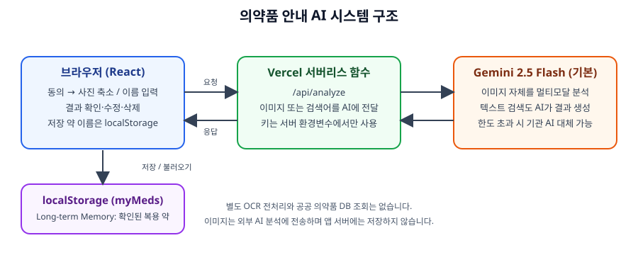
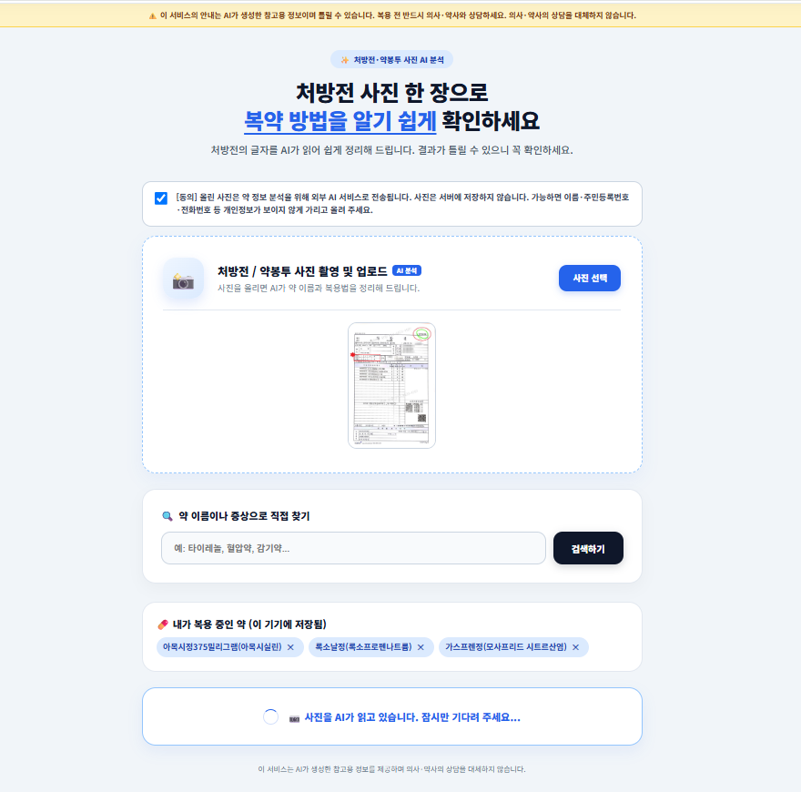
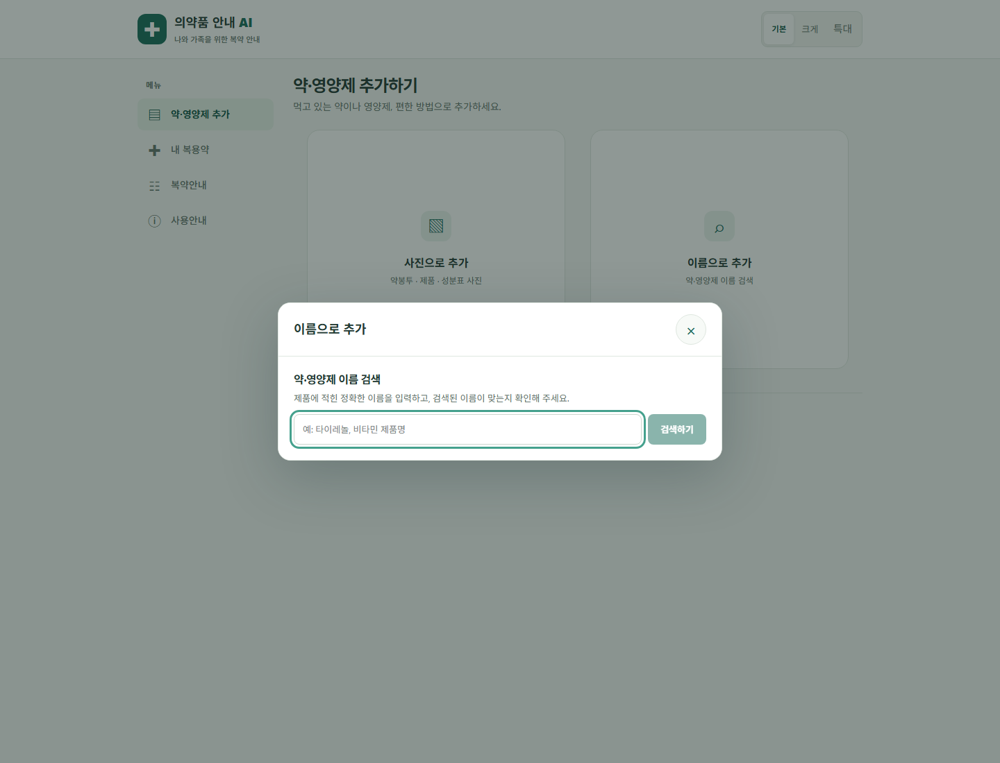
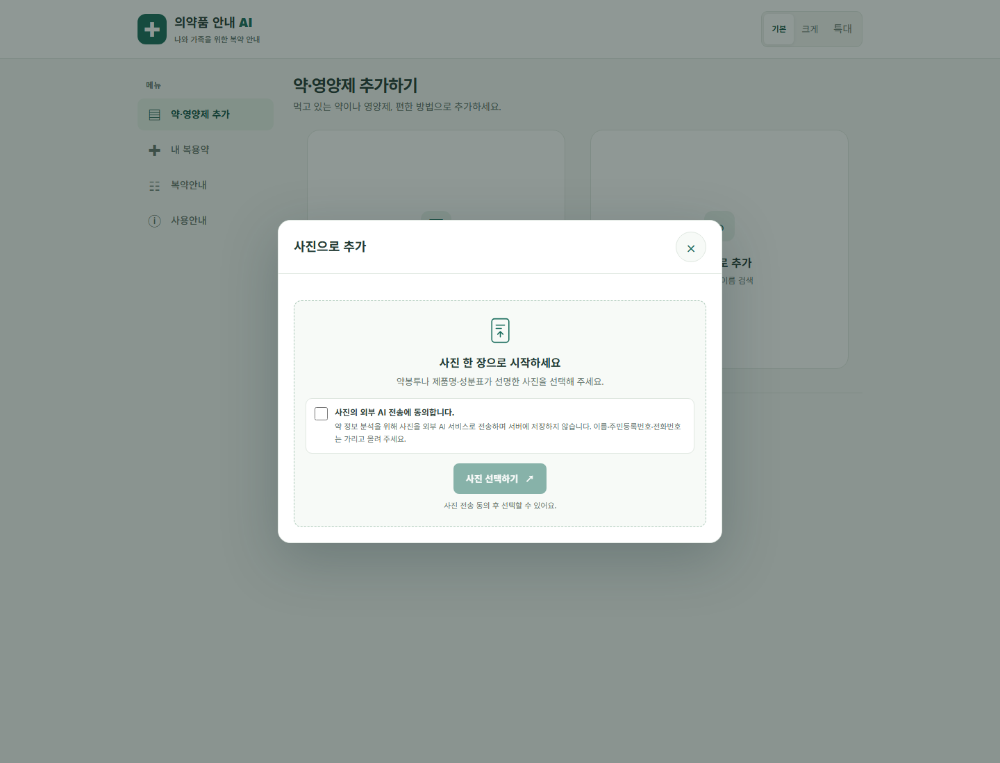
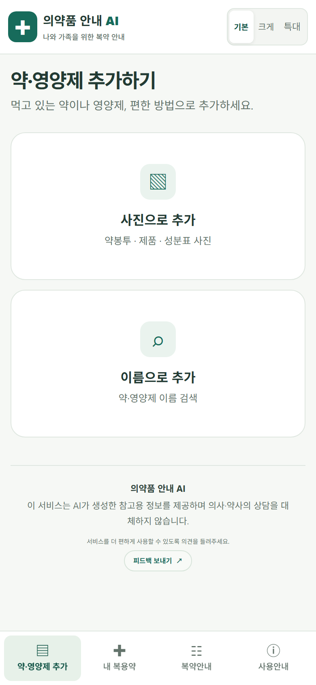
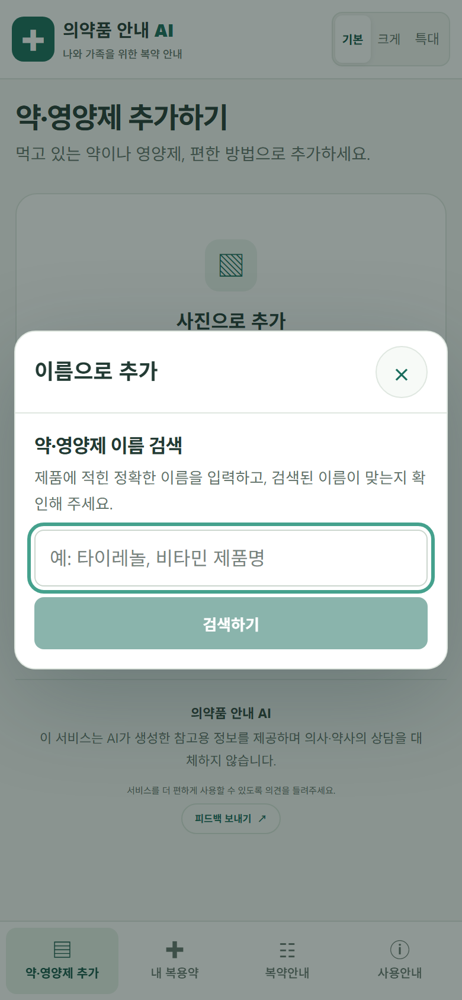
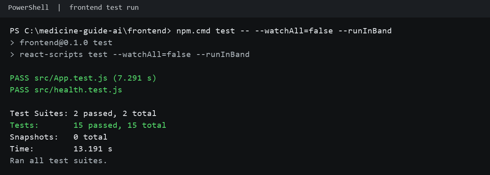

# 의약품 안내 AI (medicine-guide-ai)

처방전·약봉투 사진 한 장으로 복약 정보를 쉽게 확인하는 **노년층 대상 AI 서비스**입니다.
사진을 올리면 멀티모달 AI가 이미지 자체를 분석해 약 이름·효능·복용법·주의사항을 쉬운 말로 정리하고,
사용자가 확인·수정한 약을 저장해 두었다가 새 약과 비교해 줍니다.

- 배포 주소: https://medicine-guide-ai.vercel.app
- 팀: 최영진, 장보윤, 이채리 (Codyssey AI 네이티브 Final Project)

> ⚠️ 이 서비스의 안내는 AI가 생성한 참고용 정보이며 틀릴 수 있습니다. 복용 전 반드시 의사·약사와 상담하세요.

## 프로젝트 소개

### 문제
- 노년층은 약봉투·처방전의 작은 글자와 전문 용어를 이해하기 어렵습니다.
- 여러 병원에서 약을 받으면 새 약이 기존 복용 약과 겹치거나 주의할 점이 있는지 알기 어렵습니다.

### 해결
1. 약봉투/처방전 사진을 올리면 AI가 약 정보를 읽어 줍니다. (멀티모달 AI)
2. 인식이 틀릴 수 있으므로 사용자가 이름을 직접 수정하거나 잘못 들어온 약을 삭제한 뒤 저장합니다.
3. 저장된 복용 약 목록을 AI 요청에 함께 전달해, 새 약과 비교한 주의사항을 안내합니다. (Long-term Memory)
4. 큰 글자 모드(기본/크게/특대)와 음성 읽어주기를 제공하고, 주의사항은 클릭 없이 바로 보이게 표시합니다.

### 사용한 필수 기술 요소 (2개)
| 기술 요소 | 적용 내용 |
|---|---|
| 멀티모달 AI | 약봉투·처방전 이미지를 Gemini에 입력해 약 이름·효능·복용법·주의사항을 구조화(JSON)해서 추출 |
| Long-term Memory | 사용자가 확인한 복용 약 목록을 저장(브라우저 localStorage)하고, 다음 방문·새 약 분석 시 AI 요청에 반영해 비교 결과 생성 |

핵심 기능(새 약 비교)은 두 요소를 함께 사용합니다: 새 약 사진(멀티모달) + 저장된 복용 약(Memory) → 비교 안내.

## 팀원 및 역할
| 이름 | 역할 | 담당 업무 |
|---|---|---|
| 최영진 | 개발 · 배포 | 프론트엔드 개발, AI(Gemini) 연동 서버리스 함수, Vercel 배포, GitHub 관리 |
| 장보윤 | 기획 · 사용자 조사 · 프론트 UI 개선 | 타깃(노년층) 정의, "AI 인식 후 확인·저장" 흐름 제안, 참고 서비스 조사, 사용자 테스트, 프론트 UI 개선 |
| 이채리 | 기획 · 문서 · 발표 · 피드백 수정 반영 | 큰 글자·가족 공유 기능 제안, 복용 중인 약 기초 데이터 저장 제안, 문서·발표 자료 정리, 사용자 피드백 수정 사항 반영 |

- GitHub 계정: 최영진은 `17lucky71`(저장소 소유)과 `shine2u4best-spec`(커밋 작성) 두 계정을 사용하며 모두 같은 사람입니다.
- 협업 기록(회의 3회, PBL실 예약, 디스코드 논의): [docs/04_협업기록.md](docs/04_협업기록.md)
- 회의록: [docs/progress](docs/progress) (2026-10-05, 10-06, 10-13)

## 기술 스택
| 구분 | 사용 기술 | 선택 이유 |
|---|---|---|
| AI | Google Gemini 2.5 Flash (기본), 기관 OpenAI 호환 API (선택 대체) | 사진 또는 약 이름을 입력받아 AI가 분석 결과를 생성 |
| Frontend | React (Create React App) | 컴포넌트로 화면 구성이 간단 |
| Backend | Vercel Serverless Function (`frontend/api/analyze.js`) | 별도 서버 없이 배포, API 키를 서버 환경변수로 숨김 |
| 배포 | Vercel, GitHub (main 브랜치 push 시 자동 배포) | 외부에서 바로 접근 가능 |
| 저장 | 브라우저 localStorage | 개인정보를 서버에 두지 않는 가장 단순한 방식 |

## 시스템 구조


```
[React 브라우저]
   ├─ 사진을 최대 1400px로 축소 ─┐
   └─ 약·영양제 이름 검색어 ──────┴→ [Vercel /api/analyze] → [Gemini 멀티모달/텍스트 AI]
             ↑ 저장된 약 이름(localStorage)                         │
             └──────── 분석 JSON·비교 안내 ←────────────────────────┘
```
- 사진 분석은 별도 OCR 엔진이 문자열을 먼저 추출하는 단계 없이, 축소한 이미지 자체를 AI에 전달합니다. AI가 사진을 읽고 구조화된 결과를 생성합니다.
- 이름 검색도 공공 의약품 데이터베이스를 조회하지 않습니다. 검색어를 AI에 전달해 제품 정보를 생성하도록 요청합니다.
- Gemini가 기본 제공자입니다. `INSTITUTION_OPENAI_API_KEY`가 설정된 경우 Gemini 사용량 한도 초과 등 일부 상황에 기관 OpenAI 호환 API를 대체 경로로 사용할 수 있습니다.
- 현재 식약처 등 공신력 있는 의약품 DB 연동과 결과 대조는 구현되어 있지 않습니다. 약 이름·효능·주의사항 결과는 AI가 생성한 참고 정보이며 실제 제품과 다를 수 있습니다.
- 이미지는 분석 요청을 위해 외부 AI 서비스로 전송되며 앱 서버에는 저장하지 않습니다. 사용자가 저장한 약 이름은 브라우저 `localStorage`에 저장하고 비교 요청에 함께 보냅니다.
- AI API 키는 서버 환경변수로만 사용하며 저장소나 브라우저 코드에 넣지 않습니다.

## 실행 방법
### 요구사항
- Node.js 18+
- Gemini API 키 또는 기관 OpenAI 호환 API 키

### 로컬 실행
```bash
git clone https://github.com/17lucky71/medicine-guide-ai.git
cd medicine-guide-ai/frontend
npm install
# 서버리스 함수까지 함께 실행하려면 Vercel CLI 필요
npm i -g vercel
echo GEMINI_API_KEY=발급받은_키 > .env.local
vercel dev
```
(`npm start`만 실행하면 화면은 보이지만 `/api/analyze`가 동작하지 않습니다.)

### 배포
- Vercel에서 GitHub 저장소를 연결하고 Root Directory를 `frontend`로 설정
- Environment Variables에 `GEMINI_API_KEY` 등록 후 Deploy

## 배포 헬스체크
- 엔드포인트: `GET /api/health` (예: `https://medicine-guide-ai.vercel.app/api/health`)
- 정상 응답: HTTP `200`, JSON의 `status`가 `ok`
- 이 검사는 Vercel 서버리스 함수의 응답 여부를 확인하며 Gemini API 가용성까지 보장하지 않습니다.
- 2026-10-28 프로덕션에서 HTTP `200` 응답을 확인했습니다: [응답 스냅샷](docs/evidence/health-check-response.json) · [요청 로그](docs/evidence/health-check-response.txt)
- 2026-10-28 06:12 UTC에 프로덕션 엔드포인트를 다시 호출한 실제 응답: [헬스체크 원본 기록](docs/evidence/production-health-probe-2026-10-28.txt) (HTTP 200, Vercel 응답 헤더 포함; 단일 시점 확인)
- 최종 평가 자료에는 Vercel 대시보드의 실제 서버리스 함수 운영 로그 캡처를 추가해야 합니다. 현재 저장된 헬스체크 요청·응답 기록은 이를 대체하지 않습니다.
- PR 프리뷰는 인증 보호로 리다이렉트되었으며, 확인 경위는 [health-check-preview.txt](docs/evidence/health-check-preview.txt)에 기록했습니다.

## API 명세와 운영 측정
- API Base URL과 요청·응답 형식: [API 명세](docs/03_API명세.md) (`https://medicine-guide-ai.vercel.app/api`; 현재 `localhost:8000/api` 서버는 없음)
- 프로덕션 헬스체크와 Gemini 전체 분석 응답시간: [운영 측정 기록](docs/evidence/operations-measurement-2026-10-28.md) · [헬스체크 CSV](docs/evidence/production-health-measurement-2026-10-28.csv) · [분석 요청 CSV](docs/evidence/gemini-analysis-latency-2026-10-28.csv)
- Gemini 사진 분석은 개인정보 없는 합성 약봉투로 측정했습니다. 표본과 초기 502가 있어 장시간 가용률·공식 SLA를 입증하지 않습니다.

## 평가자 사용 방법
1. https://medicine-guide-ai.vercel.app 접속 (로그인 없음)
2. 상단 동의 체크박스에 체크
3. [사진 선택]으로 처방전 또는 약봉투 사진 업로드 → AI가 읽을 때까지 잠시 대기
4. 결과에서 약 이름이 사진과 같은지 확인하고, 틀리면 수정하거나 [이 약 삭제]
5. [확인한 약을 복용 중인 약으로 저장] 클릭 → "내가 복용 중인 약"에 표시
6. 다른 처방전 사진을 올리면 결과 상단에 저장된 약과의 비교 안내가 표시됨
7. 약 이름을 직접 입력해 검색하는 기능도 사용 가능 (예: 타이레놀)

## 화면 캡처
| 데스크톱: 약·영양제 추가 | 데스크톱: 이름으로 추가 | 데스크톱: 사진으로 추가 |
|---|---|---|
|  |  |  |

| 모바일: 약·영양제 추가 | 모바일: 이름 검색 창 |
|---|---|
|  |  |

시스템 구조도: 

2026-10-30 프로덕션 배포 화면을 개인정보 없이 캡처했습니다. 모바일 캡처는 반응형 화면 크기 에뮬레이션으로 만들었습니다.

## 자동화 테스트
- 실행 위치: `frontend/`
- 실행 명령: `npm test -- --watchAll=false --runInBand` (Windows PowerShell에서는 `npm.cmd test -- --watchAll=false --runInBand`)
- 최근 실행 결과: 테스트 스위트 2개 통과, 테스트 15개 통과 (2026-10-28)
- 실행 결과 캡처: 

## 환경 변수
| 이름 | 필수 | 설명 |
|---|---|---|
| `GEMINI_API_KEY` | 선택(기본 제공자) | Google AI Studio에서 발급한 키. 있으면 Gemini를 우선 사용합니다. Vercel 환경변수에 등록하며 서버에서만 읽습니다. |
| `GEMINI_MODEL` | 선택 | 사용할 모델 이름. 없으면 `gemini-2.5-flash` |
| `INSTITUTION_OPENAI_API_KEY` | 선택(최소 하나 필요) | 기관에서 발급한 OpenAI 호환 API 키. 단독 제공자로 쓰거나 Gemini 한도 초과 시 대체 경로로 사용 |
| `INSTITUTION_OPENAI_BASE_URL` | 선택 | 기관 API 주소. 기본값은 `https://copa.codyssey.kr/v1` |
| `INSTITUTION_OPENAI_MODEL` | 선택 | 기관 API 모델 이름. 기본값은 `gpt-5.4-mini` |

- 환경 변수는 등록한 뒤 **새로 배포(Redeploy)** 해야 적용됩니다.
- 키는 저장소에 올리지 않습니다.
- `GEMINI_API_KEY`와 `INSTITUTION_OPENAI_API_KEY` 중 하나 이상을 설정해야 분석 API가 동작합니다.

## 설계 결정과 이유
| 결정 | 이유 |
|---|---|
| 인식 결과를 바로 저장하지 않고 사용자가 확인·수정·삭제한 뒤 저장 | AI가 약 이름을 잘못 읽거나(예: 아목틴→아목시), 줄 그어진 약을 포함하는 경우가 실제 테스트에서 나왔고, 약 정보는 틀리면 위험하기 때문 |
| 복용 약을 서버 DB가 아닌 브라우저 localStorage에 저장 | 건강 정보를 서버에 보관하지 않아 개인정보 부담을 줄이기 위해. 대신 기기를 바꾸면 보이지 않는 한계가 있음 |
| AI 호출을 브라우저가 아닌 서버리스 함수에서 수행 | API 키를 서버에만 두기 위해 (브라우저에서 호출하면 키가 노출됨) |
| 저장된 약 이름 목록을 AI 요청에 함께 전달해 비교 문구를 생성 | 별도 사용자 계정·서버 DB 없이 Long-term Memory를 AI 응답에 반영 |
| 업로드 전에 브라우저에서 사진 크기를 줄여 전송 | 전송 용량과 응답 시간을 줄이기 위해 |

## 오류 처리와 입력 검증
서버리스 함수(`frontend/api/analyze.js`)가 다음과 같이 검증하고, 화면에 아래 문구를 표시합니다.

| 상황 | 응답 | 사용자에게 보이는 안내 |
|---|---|---|
| POST가 아닌 요청 | 405 | POST만 지원합니다. |
| 이미지 형식 오류 / 요청 형식 오류 | 400 | 이미지 형식이 올바르지 않습니다. / 요청 형식이 올바르지 않습니다. |
| 서버에 AI 키 없음 | 500 | 서버에 AI 키가 설정되지 않았습니다. 관리자에게 문의하세요. |
| AI 서비스 호출 실패 | 502 | AI 서비스 호출에 실패했습니다. (모델·상태 표시) |
| 사진에서 약 이름을 못 읽음 | 422 | 사진에서 약 이름을 읽지 못했습니다. 글자가 선명하게 보이도록 다시 찍어 주세요. |
| 이름 검색에서 제품을 확인하지 못함 | 422 | 입력한 이름으로 약·영양제 정보를 찾지 못했습니다. 제품명을 확인해 다시 검색해 주세요. |
| 그 밖의 오류 | 500 | 분석 중 오류가 발생했습니다. 다시 시도해 주세요. |

- 저장된 약 목록은 최대 30개, 한 이름은 60자, 검색어는 100자로 제한합니다.
- 사진 업로드는 동의 체크박스를 체크해야 진행됩니다.

## AI 활용 방식과 검증
- **서비스 안의 AI**: Gemini 2.5 Flash를 기본 제공자로 사용하고, 설정된 경우 사용량 한도 초과 시 기관 OpenAI 호환 API로 대체합니다. Gemini에는 시스템 지시문과 JSON 응답 형식을 지정합니다 (`temperature` 0.2). 지시문 규칙: 사진에 보이는 약만 적기·추측 금지, 줄 그어진 약 제외, 개인정보 출력 금지, 불확실하면 "약사에게 확인하세요".
- **검증 방법**: 팀원이 실제 처방전·약봉투 사진으로 결과를 사진 속 글자와 직접 비교 → 틀린 부분(이름 오인식, 줄 그어진 약 포함)을 기록하고 지시문과 화면(수정·삭제 단계)을 고침. 기록: [docs/05_사용자피드백기록.md](docs/05_사용자피드백기록.md)
- **개발 과정의 AI 도구**: 코드와 문서 작성에 AI 도구(Claude)를 사용했고, 결과는 팀원이 직접 실행·확인했음.
- **한계**: AI의 약 효능·주의사항·비교 안내는 일반 지식에 기반하며 공공 의약품 DB로 검증하지 않음. 그래서 모든 화면에 "참고용, 의사·약사 상담 필요" 문구를 표시함.
- **이름 검색 한계**: 제품명 검색은 공공 의약품·건강기능식품 DB 조회가 아니라, 입력한 문자열을 AI 모델에 전달해 제품 정보를 생성하도록 하는 방식임. 제품명만으로 특정 제품을 식별하거나 성분·효능·복용법의 정확성을 보장할 수 없으며, 제조사·함량·제형이 빠진 검색어는 다른 제품 정보가 섞이거나 잘못 생성될 수 있음. 공신력 있는 제품 DB 연동 전까지는 참고용 시연 기능으로 취급하고 실제 복용 판단에 사용하지 않도록 안내함.

## 구현 현황
| 기능 | 우선순위 | 상태 |
|---|---|---|
| 사진 업로드, AI 이미지 해석 | Must | 구현·확인 |
| 인식 결과 확인·수정·삭제 | Must | 구현·확인 |
| 복용 중인 약 저장 | Must | 구현·확인 |
| 새 약 비교·주의사항 | Must | 구현·확인 |
| AI 생성·참고용 문구 | Must | 구현·확인 |
| 개인정보 동의 | Must | 구현·확인 |
| 큰 글자 모드 | Should | 기본·크게·특대 선택 구현, 로고 크기 고정 |
| 화면 메뉴 | Must | 데스크톱 좌측·모바일 하단 메뉴 구현 (처방전 분석 → 내 복용약 → 복약안내 → 사용안내) |
| 사진 업로드 흐름 | Must | 동의·사진 선택·미리보기·분석 로딩을 업로드 영역 안에 통합 |
| 사용자 피드백 | Should | 공통 푸터에서 Google Form을 새 탭으로 연결 |
| 가족 공유 | Should | 미구현 |
| 로그인·DB 저장 | Could | 미구현 (향후 과제) |

### 최근 프론트엔드 업데이트
- 데스크톱은 좌측 메뉴, 모바일은 하단 메뉴로 화면을 이동합니다. 메뉴 순서는 처방전 분석, 내 복용약, 복약안내, 사용안내입니다.
- 첫 화면의 서비스 소개와 이용 순서는 사용안내 화면으로 옮겼습니다.
- 헤더에서 처음으로 버튼과 글자 크기 안내 문구를 없애고 기본·크게·특대 조절을 배치했습니다. 로고 크기는 글자 크기 조절에 영향을 받지 않습니다.
- 사진 업로드 영역 안에서 외부 AI 전송 동의를 받고 사진을 선택합니다. 선택한 사진과 AI 분석 로딩 상태도 같은 영역에 표시합니다.
- 공통 푸터의 피드백 링크는 Google Form을 새 탭으로 엽니다.

자세한 내용: [기획서](docs/01_기획서.md), [기능 요구 명세서](docs/02_기능요구명세서.md)

## Git 사용 규칙
- 폴더별로 정리: `frontend/`(앱·서버리스 함수), `docs/`(기획서·명세서·피드백·회의록)
- 작업 단위·일자별로 커밋하고 커밋 메시지에 변경 내용을 한국어로 적음
- `main`에 push하면 Vercel이 자동 배포
- API 키는 저장소에 올리지 않고 Vercel 환경변수로 관리
- 회의 기록은 `docs/progress/`에 날짜별로 보관
- 실제 병합 PR과 브랜치 이력: [저장소·PR 이력](docs/evidence/repository-history.md)
- Git author별 커밋 수: [2026-10-30 shortlog 스냅샷](docs/evidence/git-shortlog-2026-10-30.txt) (작성자 별칭을 통합하지 않은 원본 통계)
- 코드 규칙 자동검증·리팩토링: [코드 품질 기록](docs/evidence/code-quality.md), [GitHub Actions](.github/workflows/quality.yml)

## AI 윤리·개인정보
- 모든 AI 결과 화면에 "AI가 생성한 참고용 정보이며 의사·약사 상담을 대체하지 않음" 문구 표시
- 사진 업로드 전 동의 체크박스로 "사진이 약 정보 분석을 위해 외부 AI 서비스로 전송됨"을 안내
- 이름·주민등록번호·전화번호가 보이지 않게 가려서 올리도록 안내하고, AI에게도 개인정보를 결과에 포함하지 않도록 지시
- 사진은 서버에 저장하지 않으며, 복용 약 목록은 사용자의 브라우저에만 저장

## 알려진 한계
- 사진 상태에 따라 약 이름을 잘못 읽을 수 있고, 줄 그어진 약이 포함될 수 있음 → 사용자 확인·수정 단계로 보완
- 약·영양제 이름 검색은 AI 생성 결과이며 공식 제품 DB와 대조하지 않음. 정확한 제품 식별과 성분·효능 정보 보장은 개선 과제로 보류함. 향후 공신력 있는 의약품·건강기능식품 데이터 출처를 선정하고 제품 식별자 기반 조회·대조를 구현할 예정임.
- 복용 약 목록이 기기(브라우저)에만 저장되어 기기를 바꾸면 보이지 않음
- 약 비교는 AI의 일반 지식에 기반하며 공공 의약품 DB 검증을 거치지 않음

## 테스트 및 사용자 피드백
- 팀원 테스트와 Google Forms 사용자 응답을 [개발자 테스트 및 사용자 피드백 기록](docs/05_사용자피드백기록.md) 한 곳에 정리했습니다.
- Google Forms 5건의 익명화 응답 전사: [응답 자료](docs/evidence/google-forms-feedback-2026-10-28-anonymized.md) (응답자 이메일 미수집; 5명 모두 ‘처방전·약봉투 사진 분석’을 사용한 기능으로 선택)
- 기능 사용 응답 차트 원본 캡처: [Google Forms 차트](docs/evidence/google-forms-feature-use-chart.png)
- 평가 보완 현황과 다음 증거 수집 항목: [평가 증거 보완 기록](docs/evidence/evaluation-followup.md)
- 팀원 T1 테스트에서 확인된 5건 중 4건은 수정 반영했고, 줄 그어진 약이 분석에 포함되는 문제는 사용자가 삭제하도록 부분 보완했습니다.
- 2026-10-28 사용자 5명은 약물 상호작용·주의사항·음성 읽기를 긍정적으로 평가했습니다. 화면 정보량, 동의 후 사진 선택 안내, 음성 중지, 약 모양 사진을 개선 의견으로 남겼습니다.
- 재이용 의향: 예 1명(20%), 잘 모르겠어요 2명(40%), 아니요 2명(40%).

## 링크
- 배포 URL: https://medicine-guide-ai.vercel.app
- 프론트엔드 목업: [frontend/ui-preview.html](frontend/ui-preview.html)
- 사용자 피드백: [Google Form](https://docs.google.com/forms/d/e/1FAIpQLSfKYaRVm-Vt9YyEmv0wa2b-cw4jOZ37WSD4UymspIwK0cq0xA/viewform)
- 발표 자료: [docs/medicine-guide-ai.pptx](docs/medicine-guide-ai.pptx)
- 기획서: [docs/01_기획서.md](docs/01_기획서.md) · 기능 요구 명세서: [docs/02_기능요구명세서.md](docs/02_기능요구명세서.md)
- 협업 기록: [docs/04_협업기록.md](docs/04_협업기록.md) · 사용자 피드백: [docs/05_사용자피드백기록.md](docs/05_사용자피드백기록.md)
