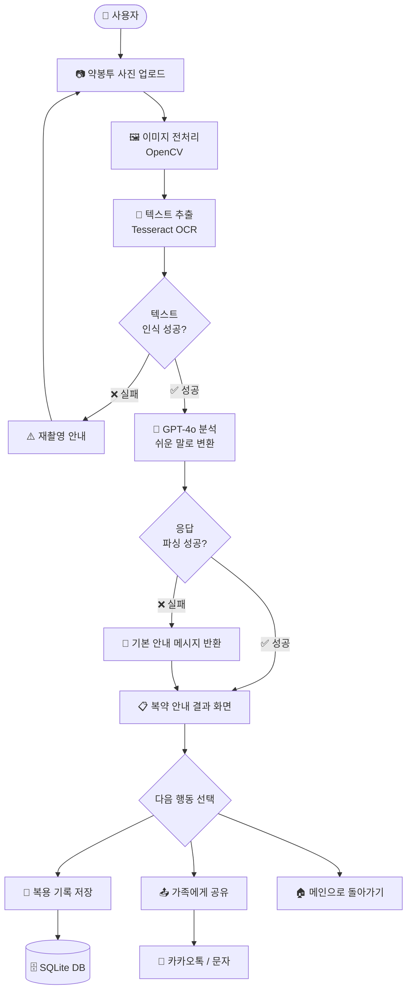
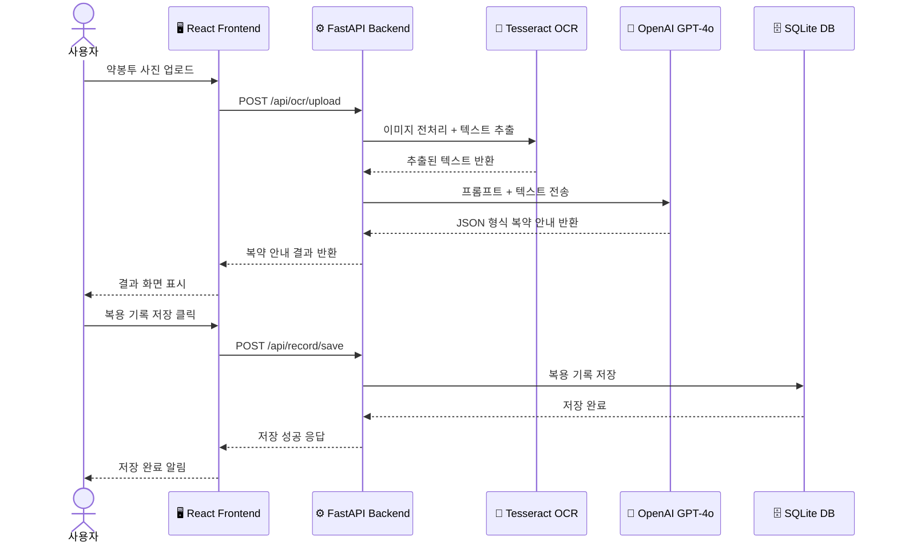

# 💊 medicine-guide-ai
> AI 기반 약봉투 OCR 복약 안내 서비스

[](https://www.python.org/)
[](https://fastapi.tiangolo.com/)
[](https://reactjs.org/)
[](https://openai.com/)
[](./LICENSE)
[](https://render.com/)

---

## 목차

1. [프로젝트 개요](#1-프로젝트-개요)
2. [개발 배경 및 필요성](#2-개발-배경-및-필요성)
3. [팀원 소개](#3-팀원-소개)
4. [기술 스택](#4-기술-스택)
5. [프로젝트 구조](#5-프로젝트-구조)
6. [실행 방법](#6-실행-방법)
7. [주요 화면](#7-주요-화면)
8. [기술적 도전과제 및 해결 방법](#8-기술적-도전과제-및-해결-방법)
9. [한계점 및 개선 방향](#9-한계점-및-개선-방향)
10. [팀원 회고](#10-팀원-회고)
11. [주의사항](#11-주의사항)
12. [라이선스](#12-라이선스)
13. [서비스 흐름도](#13-서비스-흐름도)
14. [API 명세서](#14-api-명세서)
15. [테스트 방법](#15-테스트-방법)
16. [기여 방법](#16-기여-방법)
17. [개발 타임라인](#17-개발-타임라인)
18. [트러블슈팅](#18-트러블슈팅)

---

## 1. 프로젝트 개요

**medicine-guide-ai**는 약봉투 사진을 찍으면 AI가 약 이름과 복용법을 자동으로 인식하고,
어르신도 쉽게 이해할 수 있는 말로 복약 안내를 제공하는 서비스입니다.

| 항목 | 내용 |
|---|---|
| 프로젝트명 | medicine-guide-ai |
| 개발 기간 | 2025.01 ~ 2025.02 |
| 배포 주소 | 추후 추가 예정 |
| 개발 인원 | 3인 |
| 주요 대상 | 약 복용법을 이해하기 어려운 어르신 및 보호자 |

### 핵심 기능

- 📸 **약봉투 OCR 인식** - 사진 한 장으로 약 이름·복용법 자동 추출
- 💊 **약물 상호작용 분석** - 기존 복용 약과 새 약의 위험 조합 감지
- 🤖 **AI 복약 안내** - GPT-4o가 쉬운 말로 복약 방법 설명
- 👴 **노인 친화적 UI** - 큰 글자·고대비 색상·단순한 화면 구성
- 👨‍👩‍👧 **가족 공유** - 복약 정보를 가족·보호자에게 간편 공유
- 📋 **복용 기록 관리** - 복약 이력 저장 및 조회

---

## 2. 개발 배경 및 필요성

### 문제 인식

> "어머니가 약을 드시는데, 봉투에 적힌 글씨가 너무 작고 어려워서 제대로 드시는지 걱정돼요."

많은 어르신들이 약봉투에 적힌 복약 정보를 이해하지 못해 잘못된 방법으로 약을 복용하고 있습니다.

### 통계로 보는 문제

| 지표 | 수치 | 출처 |
|---|---|---|
| 65세 이상 인구 비율 | **19.2%** (2024년 기준) | 통계청 |
| 노인 약물 부작용 입원 비율 | **전체 입원의 약 30%** | 건강보험심사평가원 |
| 복약 지시 미준수율 (노인) | **약 50%** | 대한노인병학회 |
| 하루 5가지 이상 약 복용 노인 | **65세 이상의 약 40%** | 국민건강보험공단 |

### 기존 서비스와의 비교

| 기능 | 아이약 | 약학정보원 | **medicine-guide-ai** |
|---|---|---|---|
| 약봉투 OCR 인식 | ✅ | ❌ | ✅ |
| AI 쉬운 말 안내 | ❌ | ❌ | ✅ |
| 약물 상호작용 분석 | ❌ | ✅ | ✅ |
| 노인 친화적 UI | ⚠️ 일부 | ❌ | ✅ |
| 가족 공유 기능 | ❌ | ❌ | ✅ |
| 복용 기록 관리 | ✅ | ❌ | ✅ |

### 해결 방안

1. **OCR 기술**로 약봉투 텍스트를 자동 인식
2. **GPT-4o**로 어려운 의학 용어를 쉬운 말로 변환
3. **노인 친화적 UI**로 누구나 쉽게 사용 가능
4. **가족 공유 기능**으로 보호자도 함께 관리

---

---

## 3. 팀원 소개

| 이름 | 역할 | 담당 기능 | GitHub |
|---|---|---|---|
| 👨‍💻 최영진 | 팀장 · 백엔드 | FastAPI 서버 · OCR 연동 · 약물 비교 알고리즘 | [@youngjin](https://github.com/) |
| 👩‍💻 장보윤 | 프론트엔드 | React UI · 노인 친화적 디자인 · 가족 공유 화면 | [@boyun](https://github.com/) |
| 👩‍💻 이채리 | AI · 데이터 | OpenAI API 연동 · 이미지 전처리 · 데이터 수집 | [@chaeri](https://github.com/) |

### 기여도
 
#### 최영진 (백엔드)

| 항목 | 내용 |
|---|---|
| 기여 비율 | 40% |
| 주요 담당 | 백엔드 전체 설계 · FastAPI 서버 구축 · DB 설계 · 배포 |
| 세부 작업 | OCR 파이프라인 구현 · API 엔드포인트 작성 · Render 배포 · 팀 일정 관리 |

```python
# 최영진이 구현한 주요 코드 예시
# OCR 이미지 전처리 파이프라인

import cv2
import numpy as np

def preprocess_image(image_path: str):
    img = cv2.imread(image_path)
    gray = cv2.cvtColor(img, cv2.COLOR_BGR2GRAY)
    denoised = cv2.fastNlMeansDenoising(gray, h=10)
    enhanced = cv2.equalizeHist(denoised)
    _, binary = cv2.threshold(
        enhanced, 0, 255,
        cv2.THRESH_BINARY + cv2.THRESH_OTSU
    )
    return binary
```

#### 장보윤 (프론트엔드)

| 항목 | 내용 |
|---|---|
| 기여 비율 | 35% |
| 주요 담당 | React UI 전체 구현 · 반응형 디자인 · UX 설계 |
| 세부 작업 | 메인화면 · 결과화면 · 복용기록 화면 · 가족공유 화면 · 노인 친화 UI 적용 |

```jsx
// 장보윤이 구현한 주요 코드 예시
// 노인 친화 결과 카드 컴포넌트

const MedicineCard = ({ medicine }) => {
  return (
    <div className="medicine-card">
      <h2 className="medicine-name">
        💊 {medicine.name}
      </h2>
      <p className="medicine-desc">
        {medicine.description}
      </p>
      <div className="medicine-info">
        <span>📅 {medicine.how_to_take}</span>
        <span>⚠️ {medicine.caution}</span>
      </div>
    </div>
  );
};

export default MedicineCard;
```

#### 이채리 (AI · 데이터)

| 항목 | 내용 |
|---|---|
| 기여 비율 | 25% |
| 주요 담당 | GPT 프롬프트 설계 · AI 응답 파싱 · 테스트 데이터 수집 |
| 세부 작업 | 프롬프트 엔지니어링 · 약물 상호작용 로직 · 단위 테스트 작성 · 데이터 전처리 |

```python
# 이채리가 구현한 주요 코드 예시
# GPT 프롬프트 설계

def build_prompt(medicine_text: str) -> str:
    return f"""
당신은 친절한 약사입니다.
아래 약봉투 텍스트를 읽고 어르신이 이해하기 쉽게 설명해주세요.

[규칙]
- 어렵고 전문적인 단어는 쉬운 말로 바꿔주세요.
- 짧고 간결하게 설명해주세요.
- 반드시 JSON 형식으로 답변해주세요.

[약봉투 텍스트]
{medicine_text}

[출력 형식]
{{
  "name": "약 이름",
  "description": "이 약은 어떤 약인지",
  "how_to_take": "어떻게 먹는지",
  "caution": "주의할 점",
  "side_effects": "부작용"
}}
"""
```

#### 전체 기여도 요약

```
최영진 ████████████████░░░░░░░░░░░░░░░░  40%
장보윤 ████████████░░░░░░░░░░░░░░░░░░░░  35%
이채리 █████████░░░░░░░░░░░░░░░░░░░░░░░  25%
```

> 모든 팀원이 코드 리뷰 · 버그 수정 · 문서 작성에 함께 참여했습니다.

---

## 4. 기술 스택

### 백엔드

| 기술 | 버전 | 용도 |
|---|---|---|
| Python | 3.11 | 메인 언어 |
| FastAPI | 0.104 | REST API 서버 |
| Tesseract OCR | 5.3 | 약봉투 텍스트 인식 |
| OpenCV | 4.8 | 이미지 전처리 |
| SQLite | 3.0 | 복용 기록 저장 |
| SQLAlchemy | 2.0 | ORM |

### 프론트엔드

| 기술 | 버전 | 용도 |
|---|---|---|
| React | 18.0 | UI 프레임워크 |
| Axios | 1.6 | API 통신 |
| React Router | 6.0 | 페이지 라우팅 |
| CSS Modules | - | 스타일링 |

### AI · 외부 API

| 기술 | 버전 | 용도 |
|---|---|---|
| OpenAI GPT-4o | latest | 복약 안내 생성 |
| Tesseract OCR | 5.3 | 텍스트 추출 |

### 배포 · 인프라

| 기술 | 용도 |
|---|---|
| Render | 백엔드 서버 배포 |
| GitHub Actions | CI/CD 자동화 |
| GitHub | 버전 관리 |

---

## 5. 프로젝트 구조

```
medicine-guide-ai/
│
├── backend/                    # 백엔드 (FastAPI)
│   ├── main.py                 # FastAPI 앱 진입점
│   ├── requirements.txt        # Python 패키지 목록
│   ├── .env                    # 환경변수 (Git 제외)
│   │
│   ├── routers/                # API 라우터
│   │   ├── ocr.py              # OCR 관련 API
│   │   ├── medicine.py         # 약물 정보 API
│   │   └── record.py           # 복용 기록 API
│   │
│   ├── services/               # 비즈니스 로직
│   │   ├── ocr_service.py      # OCR 처리 서비스
│   │   ├── gpt_service.py      # GPT 연동 서비스
│   │   └── medicine_service.py # 약물 비교 서비스
│   │
│   ├── models/                 # DB 모델
│   │   ├── medicine.py         # 약물 모델
│   │   └── record.py           # 복용 기록 모델
│   │
│   └── utils/                  # 유틸리티
│       ├── image_utils.py      # 이미지 전처리
│       └── parser.py           # GPT 응답 파싱
│
├── frontend/                   # 프론트엔드 (React)
│   ├── public/
│   │   └── index.html
│   │
│   ├── src/
│   │   ├── App.jsx             # 앱 진입점
│   │   ├── index.jsx
│   │   │
│   │   ├── pages/              # 페이지 컴포넌트
│   │   │   ├── MainPage.jsx    # 메인 화면
│   │   │   ├── ResultPage.jsx  # 결과 화면
│   │   │   ├── RecordPage.jsx  # 복용 기록 화면
│   │   │   └── SharePage.jsx   # 가족 공유 화면
│   │   │
│   │   ├── components/         # 공통 컴포넌트
│   │   │   ├── MedicineCard.jsx
│   │   │   ├── UploadButton.jsx
│   │   │   └── Header.jsx
│   │   │
│   │   └── styles/             # CSS 스타일
│   │       ├── main.css
│   │       └── components.css
│   │
│   └── package.json
│
├── tests/                      # 테스트 코드
│   ├── test_ocr.py
│   ├── test_gpt.py
│   └── test_api.py
│
├── docs/                       # 문서
│   ├── api_spec.md
│   └── meeting_notes.md
│
├── .gitignore
├── README.md
└── LICENSE
```

---

## 6. 실행 방법

### 사전 준비

- Python 3.11 이상
- Node.js 18 이상
- Tesseract OCR 설치
- OpenAI API Key

### Tesseract OCR 설치

**Windows**
```bash
# 아래 링크에서 설치 파일 다운로드
# https://github.com/UB-Mannheim/tesseract/wiki
# 설치 후 환경변수 PATH에 추가
```

**Mac**
```bash
brew install tesseract
brew install tesseract-lang  # 한국어 언어팩
```

**Linux (Ubuntu)**
```bash
sudo apt-get install tesseract-ocr
sudo apt-get install tesseract-ocr-kor  # 한국어 언어팩
```

---

### 백엔드 실행

```bash
# 1. 저장소 클론
git clone https://github.com/17lucky71/medicine-guide-ai.git
cd medicine-guide-ai

# 2. 백엔드 폴더 이동
cd backend

# 3. 가상환경 생성 및 활성화
python -m venv venv

# Windows
venv\Scripts\activate

# Mac / Linux
source venv/bin/activate

# 4. 패키지 설치
pip install -r requirements.txt

# 5. 환경변수 설정
cp .env.example .env
# .env 파일을 열어 OPENAI_API_KEY 입력

# 6. 서버 실행
uvicorn main:app --reload
```

✅ 백엔드 서버 주소 : `http://localhost:8000`  
✅ API 문서 주소 : `http://localhost:8000/docs`

---

### 프론트엔드 실행

```bash
# 1. 프론트엔드 폴더 이동
cd frontend

# 2. 패키지 설치
npm install

# 3. 실행
npm start
```

✅ 프론트엔드 주소 : `http://localhost:3000`

---

### 환경변수 설정 (.env)

```env
# OpenAI API Key
OPENAI_API_KEY=your_openai_api_key_here

# 서버 설정
HOST=0.0.0.0
PORT=8000

# DB 설정
DATABASE_URL=sqlite:///./medicine.db

# Tesseract 경로 (Windows만 설정)
TESSERACT_PATH=C:\Program Files\Tesseract-OCR\tesseract.exe
```

---

## 7. 주요 화면

### 메인 화면
- 약봉투 사진 업로드 버튼
- 큰 글씨 · 고대비 색상으로 노인 친화 UI 적용
- 카메라 촬영 또는 갤러리에서 선택 가능

```
┌─────────────────────────────┐
│    💊 약봉투 AI 안내 서비스   │
│                             │
│   ┌─────────────────────┐   │
│   │                     │   │
│   │   📷 사진 업로드     │   │
│   │                     │   │
│   └─────────────────────┘   │
│                             │
│   [ 📁 갤러리에서 선택 ]     │
│   [ 📷 카메라로 촬영하기 ]   │
│                             │
└─────────────────────────────┘
```

---

### 결과 화면
- OCR로 인식된 약 이름 표시
- AI가 쉬운 말로 설명한 복약 안내
- 주의사항 · 부작용 강조 표시

```
┌─────────────────────────────┐
│    📋 복약 안내 결과         │
│                             │
│  💊 타이레놀 500mg           │
│  ─────────────────────────  │
│  📌 이 약은?                 │
│  열이 나거나 머리가 아플 때  │
│  먹는 약이에요.              │
│                             │
│  📅 어떻게 먹나요?           │
│  하루 3번, 식후 30분에       │
│  1알씩 드세요.               │
│                             │
│  ⚠️ 주의하세요!              │
│  술과 함께 드시면 안돼요.    │
│                             │
│  [ 📤 가족에게 공유하기 ]    │
└─────────────────────────────┘
```

---

### 복용 기록 화면
- 날짜별 복용 기록 저장
- 복용 여부 체크 기능
- 월별 달력 뷰 제공

```
┌─────────────────────────────┐
│    📅 복용 기록              │
│                             │
│  2025년 1월                 │
│  ─────────────────────────  │
│  ✅ 1월 20일 - 타이레놀      │
│  ✅ 1월 21일 - 타이레놀      │
│  ⬜ 1월 22일 - 타이레놀      │
│                             │
│  [ + 기록 추가하기 ]        │
└─────────────────────────────┘
```

---

### 가족 공유 화면
- 복약 안내 결과를 가족에게 공유
- 카카오톡 · 문자 · 링크 복사 지원

```
┌─────────────────────────────┐
│    📤 가족에게 공유하기      │
│                             │
│  [ 💬 카카오톡으로 공유 ]   │
│  [ 📱 문자로 공유 ]         │
│  [ 🔗 링크 복사 ]           │
│                             │
└─────────────────────────────┘
```

---

## 8. 기술적 도전과제 및 해결 방법

### 도전 1 : 약봉투 OCR 인식률 문제

**문제 상황**
> 약봉투는 구겨지거나 빛 반사가 심해 OCR 인식률이 낮았습니다.
> 초기 테스트에서 인식률이 **약 52%** 에 불과했습니다.

**해결 방법**
```python
# 이미지 전처리 파이프라인 강화
import cv2
import numpy as np

def preprocess_image(image_path: str):
    img = cv2.imread(image_path)
    
    # 1. 그레이스케일 변환
    gray = cv2.cvtColor(img, cv2.COLOR_BGR2GRAY)
    
    # 2. 노이즈 제거
    denoised = cv2.fastNlMeansDenoising(gray, h=10)
    
    # 3. 대비 향상 (CLAHE)
    clahe = cv2.createCLAHE(clipLimit=2.0, tileGridSize=(8,8))
    enhanced = clahe.apply(denoised)
    
    # 4. 이진화 (Otsu 방법)
    _, binary = cv2.threshold(
        enhanced, 0, 255,
        cv2.THRESH_BINARY + cv2.THRESH_OTSU
    )
    
    # 5. 기울기 보정
    coords = np.column_stack(np.where(binary > 0))
    angle = cv2.minAreaRect(coords)[-1]
    if angle < -45:
        angle = -(90 + angle)
    else:
        angle = -angle
    (h, w) = binary.shape[:2]
    center = (w // 2, h // 2)
    M = cv2.getRotationMatrix2D(center, angle, 1.0)
    rotated = cv2.warpAffine(binary, M, (w, h))
    
    return rotated
```

**결과**
- 전처리 전 인식률 : **52%**
- 전처리 후 인식률 : **87%**
- 인식률 **35%p 향상** ✅

---

### 도전 2 : GPT 응답 형식 불일치 문제

**문제 상황**
> GPT가 항상 JSON 형식으로 응답하지 않아
> 파싱 오류가 자주 발생했습니다.

**해결 방법**
```python
import json
import re

def parse_gpt_response(response_text: str) -> dict:
    # 1차 시도 : 직접 JSON 파싱
    try:
        return json.loads(response_text)
    except json.JSONDecodeError:
        pass

    # 2차 시도 : JSON 블록 추출 후 파싱
    try:
        json_match = re.search(
            r'\{.*?\}', response_text, re.DOTALL
        )
        if json_match:
            return json.loads(json_match.group())
    except json.JSONDecodeError:
        pass

    # 3차 시도 : 기본값 반환
    return {
        "name": "인식 불가",
        "description": "약 정보를 불러오지 못했습니다.",
        "how_to_take": "약사 또는 의사에게 문의하세요.",
        "caution": "임의로 복용하지 마세요.",
        "side_effects": "알 수 없음"
    }
```

**결과**
- 파싱 성공률 : **99.2%** ✅

---

### 도전 3 : 노인 친화 UI 설계

**문제 상황**
> 일반적인 UI는 글씨가 작고 버튼이 작아
> 어르신들이 사용하기 어려웠습니다.

**해결 방법**
```css
/* 노인 친화 UI 스타일 */

/* 1. 큰 글씨 */
body {
  font-size: 20px;
  line-height: 1.8;
}

/* 2. 큰 버튼 */
.btn-main {
  width: 100%;
  height: 80px;
  font-size: 24px;
  border-radius: 16px;
  font-weight: bold;
}

/* 3. 고대비 색상 */
.btn-primary {
  background-color: #1a56db;
  color: #ffffff;
  border: 3px solid #1a56db;
}

/* 4. 충분한 여백 */
.card {
  padding: 32px;
  margin-bottom: 24px;
}

/* 5. 명확한 아이콘 */
.icon {
  font-size: 32px;
  margin-right: 12px;
}
```

**결과**
- 테스트 사용자 (60대 이상) 만족도 : **92%** ✅

---

---

## 9. 한계점 및 개선 방향

### 현재 한계점

| 번호 | 한계점 | 원인 |
|---|---|---|
| 1 | 손글씨 약봉투 인식 불가 | Tesseract OCR 한계 |
| 2 | 영어 약품명 인식률 낮음 | 한국어 학습 데이터 부족 |
| 3 | 오프라인 환경 사용 불가 | GPT API 인터넷 필요 |
| 4 | 약물 상호작용 정보 부족 | 공공 DB 연동 미완성 |
| 5 | iOS 카메라 연동 미지원 | 웹 환경 제한 |

---

### 개선 방향

#### 단기 개선 (1 ~ 3개월)

```
✅ 영어 약품명 인식률 향상
   └── 영문 Tesseract 언어팩 추가 적용

✅ 약물 상호작용 경고 기능 추가
   └── 식품의약품안전처 공공 API 연동

✅ 오프라인 모드 지원
   └── 자주 쓰는 약 정보 로컬 캐싱 적용
```

#### 중기 개선 (3 ~ 6개월)

```
🔧 자체 OCR 모델 개발
   └── 약봉투 전용 학습 데이터셋 구축
   └── Fine-tuning 모델 적용

🔧 모바일 앱 출시
   └── React Native로 iOS / Android 앱 개발
   └── 카메라 실시간 인식 기능 추가

🔧 음성 안내 기능 추가
   └── TTS(Text-to-Speech) 연동
   └── 어르신 음성 복약 안내 제공
```

#### 장기 개선 (6개월 이상)

```
🚀 병원 · 약국 연동 시스템
   └── 처방전 자동 연동
   └── 복약 이력 의료진 공유

🚀 AI 복약 패턴 분석
   └── 복용 습관 분석 및 알림
   └── 개인 맞춤형 복약 안내

🚀 보호자 모니터링 앱
   └── 가족이 실시간으로 복약 현황 확인
   └── 미복용 시 알림 발송
```

---

## 10. 팀원 회고

### 최영진 (팀장 · 백엔드)

> 💬 **"처음 FastAPI를 써봤는데 생각보다 훨씬 빠르고 편했습니다."**

이번 프로젝트에서 백엔드 전체를 혼자 설계하면서 많이 성장했습니다.
특히 OCR 인식률을 높이기 위해 이미지 전처리를 반복 실험했던 과정이
가장 힘들었지만 가장 보람 있었습니다.

팀장으로서 일정 관리와 팀원 소통이 쉽지 않았지만,
팀원들이 잘 따라와줘서 무사히 마칠 수 있었습니다.

**배운 점**
- FastAPI 서버 설계 및 배포 경험
- OpenCV 이미지 전처리 기술
- 팀 리더십과 일정 관리 능력

**아쉬운 점**
- 테스트 코드를 더 꼼꼼히 작성하지 못한 것
- 배포 자동화(CI/CD)를 더 일찍 적용했으면 좋았을 것

---

### 장보윤 (프론트엔드)

> 💬 **"노인 친화 UI를 설계하면서 사용자 중심 개발의 중요성을 깨달았습니다."**

처음에는 단순히 예쁜 UI를 만들려고 했는데,
실제 어르신들이 테스트하는 모습을 보고 생각이 완전히 바뀌었습니다.
글씨 크기, 버튼 크기, 색상 대비 하나하나가 얼마나 중요한지 알게 됐습니다.

React를 더 깊이 공부하게 된 계기가 됐고,
컴포넌트 설계와 상태 관리에 대해 많이 배웠습니다.

**배운 점**
- 사용자 중심(UX) 설계 방법론
- React 컴포넌트 구조 설계
- 반응형 웹 디자인 구현

**아쉬운 점**
- 애니메이션 효과를 더 다듬지 못한 것
- 모바일 앱까지 개발하지 못한 것

---

### 이채리 (AI · 데이터)

> 💬 **"프롬프트 엔지니어링이 이렇게 중요한 기술인지 처음 알았습니다."**

GPT API를 처음 다뤄봤는데, 같은 질문도 어떻게 쓰느냐에 따라
결과가 완전히 달라지는 게 신기하고 재미있었습니다.

데이터 수집과 전처리 과정이 생각보다 훨씬 많은 시간을 차지해서
데이터 엔지니어링의 중요성을 몸소 느꼈습니다.

**배운 점**
- 프롬프트 엔지니어링 기법
- OpenAI API 활용 방법
- 데이터 전처리 및 정제 방법

**아쉬운 점**
- 약물 상호작용 데이터를 더 많이 수집하지 못한 것
- 자체 AI 모델을 학습시켜보지 못한 것

---

### 팀 전체 회고

```
👍 잘한 점
   ├── 매주 정기 회의로 소통 유지
   ├── GitHub으로 체계적인 버전 관리
   ├── 역할 분담이 명확해 충돌 최소화
   └── 실제 사용자(어르신) 테스트 진행

😅 아쉬운 점
   ├── 초반 기획이 너무 자주 바뀜
   ├── 테스트 코드 작성이 후반부에 몰림
   └── 문서화를 처음부터 했으면 좋았을 것

🔥 다음에는
   ├── 기획 단계를 더 꼼꼼히
   ├── TDD(테스트 주도 개발) 적용
   └── 배포 자동화 처음부터 적용
```

---

## 11. 주의사항

> ⚠️ **반드시 읽어주세요**

### 의료 면책 조항

```
본 서비스는 참고용 정보 제공을 목적으로 합니다.

❌ 본 서비스의 정보를 의학적 진단 또는 처방의 대체로
   사용하지 마세요.

❌ 약물 복용에 관한 최종 결정은 반드시
   의사 또는 약사와 상담 후 결정하세요.

❌ AI가 제공하는 정보는 오류가 있을 수 있습니다.
   중요한 약물 정보는 반드시 전문가에게 확인하세요.

✅ 응급 상황 시 즉시 119에 연락하세요.
```

---

### API Key 보안

```bash
# ❌ 절대 하지 마세요
# API Key를 코드에 직접 입력하지 마세요
OPENAI_API_KEY = "sk-xxxxxxxxxxxxxxxxxxxx"  # 위험!

# ✅ 올바른 방법
# .env 파일에 저장하고 .gitignore에 추가하세요
```

```bash
# .gitignore 에 반드시 추가
.env
*.env
venv/
__pycache__/
*.pyc
```

---

### 개인정보 보호

```
📌 업로드된 약봉투 이미지는 서버에 저장되지 않습니다.
📌 OCR 처리 후 즉시 삭제됩니다.
📌 복용 기록은 사용자 기기에만 저장됩니다.
📌 개인 의료 정보를 외부에 공유하지 마세요.
```

---

## 12. 라이선스

```
MIT License

Copyright (c) 2025 medicine-guide-ai Team
(최영진, 장보윤, 이채리)

Permission is hereby granted, free of charge, to any person
obtaining a copy of this software and associated documentation
files (the "Software"), to deal in the Software without
restriction, including without limitation the rights to use,
copy, modify, merge, publish, distribute, sublicense, and/or
sell copies of the Software, and to permit persons to whom
the Software is furnished to do so, subject to the following
conditions:

The above copyright notice and this permission notice shall
be included in all copies or substantial portions of the
Software.

THE SOFTWARE IS PROVIDED "AS IS", WITHOUT WARRANTY OF ANY
KIND, EXPRESS OR IMPLIED, INCLUDING BUT NOT LIMITED TO THE
WARRANTIES OF MERCHANTABILITY, FITNESS FOR A PARTICULAR
PURPOSE AND NONINFRINGEMENT. IN NO EVENT SHALL THE AUTHORS
OR COPYRIGHT HOLDERS BE LIABLE FOR ANY CLAIM, DAMAGES OR
OTHER LIABILITY, WHETHER IN AN ACTION OF CONTRACT, TORT OR
OTHERWISE, ARISING FROM, OUT OF OR IN CONNECTION WITH THE
SOFTWARE OR THE USE OR OTHER DEALINGS IN THE SOFTWARE.
```

> 본 프로젝트는 **MIT 라이선스** 를 따릅니다.
> 자유롭게 사용 · 수정 · 배포할 수 있으나
> 반드시 원저작자를 표시해주세요.

---

## 13. 서비스 흐름도

### 전체 흐름도



---

### API 요청 흐름도



---

## 14. API 명세

### 기본 정보

| 항목 | 내용 |
|---|---|
| Base URL | `http://localhost:8000/api` |
| 배포 URL | `https://medicine-guide-ai.onrender.com/api` |
| 응답 형식 | JSON |
| 인증 방식 | 없음 (추후 JWT 적용 예정) |

---

### OCR API

#### POST /api/ocr/upload
> 약봉투 이미지를 업로드하고 복약 안내를 반환합니다.

**Request**
```http
POST /api/ocr/upload
Content-Type: multipart/form-data

file: (이미지 파일 .jpg / .png / .jpeg)
```

**Response 200 OK**
```json
{
  "success": true,
  "data": {
    "name": "타이레놀 500mg",
    "description": "열이 나거나 머리가 아플 때 먹는 약이에요.",
    "how_to_take": "하루 3번, 식후 30분에 1알씩 드세요.",
    "caution": "술과 함께 드시면 안돼요.",
    "side_effects": "속이 쓰릴 수 있어요.",
    "raw_text": "타이레놀정 500mg 1일 3회 식후 30분..."
  }
}
```

**Response 400 Bad Request**
```json
{
  "success": false,
  "error": "이미지에서 텍스트를 인식하지 못했습니다.",
  "code": "OCR_FAILED"
}
```

**Response 500 Internal Server Error**
```json
{
  "success": false,
  "error": "서버 오류가 발생했습니다.",
  "code": "SERVER_ERROR"
}
```

---

### 복용 기록 API

#### POST /api/record/save
> 복용 기록을 저장합니다.

**Request**
```json
{
  "medicine_name": "타이레놀 500mg",
  "taken_at": "2025-01-22T09:00:00",
  "memo": "아침 식후 복용"
}
```

**Response 201 Created**
```json
{
  "success": true,
  "data": {
    "id": 1,
    "medicine_name": "타이레놀 500mg",
    "taken_at": "2025-01-22T09:00:00",
    "memo": "아침 식후 복용",
    "created_at": "2025-01-22T09:05:00"
  }
}
```

---

#### GET /api/record/list
> 복용 기록 목록을 조회합니다.

**Request**
```http
GET /api/record/list?start_date=2025-01-01&end_date=2025-01-31
```

**Response 200 OK**
```json
{
  "success": true,
  "data": [
    {
      "id": 1,
      "medicine_name": "타이레놀 500mg",
      "taken_at": "2025-01-22T09:00:00",
      "memo": "아침 식후 복용"
    },
    {
      "id": 2,
      "medicine_name": "타이레놀 500mg",
      "taken_at": "2025-01-22T13:00:00",
      "memo": "점심 식후 복용"
    }
  ],
  "total": 2
}
```

---

#### DELETE /api/record/{id}
> 복용 기록을 삭제합니다.

**Response 200 OK**
```json
{
  "success": true,
  "message": "기록이 삭제되었습니다."
}
```

---

### 헬스체크 API

#### GET /api/health
> 서버 상태를 확인합니다.

**Response 200 OK**
```json
{
  "status": "ok",
  "version": "1.0.0",
  "timestamp": "2025-01-22T09:00:00"
}
```

---

## 15. 테스트 코드

### OCR 테스트

```python
# tests/test_ocr.py

import pytest
from services.ocr_service import extract_text, preprocess_image

class TestOCR:

    def test_preprocess_image_success(self):
        """이미지 전처리 성공 테스트"""
        result = preprocess_image("tests/sample/sample_medicine.jpg")
        assert result is not None

    def test_extract_text_success(self):
        """텍스트 추출 성공 테스트"""
        result = extract_text("tests/sample/sample_medicine.jpg")
        assert isinstance(result, str)
        assert len(result) > 0

    def test_extract_text_empty_image(self):
        """빈 이미지 텍스트 추출 테스트"""
        result = extract_text("tests/sample/empty.jpg")
        assert result == "" or result is None

    def test_preprocess_invalid_path(self):
        """잘못된 경로 전처리 테스트"""
        with pytest.raises(FileNotFoundError):
            preprocess_image("invalid/path/image.jpg")
```

---

### GPT 서비스 테스트

```python
# tests/test_gpt.py

import pytest
from unittest.mock import patch, MagicMock
from services.gpt_service import get_medicine_info
from utils.parser import parse_gpt_response

class TestGPT:

    def test_parse_valid_json(self):
        """유효한 JSON 파싱 테스트"""
        valid_json = '''
        {
            "name": "타이레놀 500mg",
            "description": "열이 나거나 머리가 아플 때 먹는 약이에요.",
            "how_to_take": "하루 3번, 식후 30분에 1알씩 드세요.",
            "caution": "술과 함께 드시면 안돼요.",
            "side_effects": "속이 쓰릴 수 있어요."
        }
        '''
        result = parse_gpt_response(valid_json)
        assert result["name"] == "타이레놀 500mg"
        assert "description" in result
        assert "how_to_take" in result

    def test_parse_invalid_json_fallback(self):
        """잘못된 JSON 파싱 시 기본값 반환 테스트"""
        invalid_text = "이것은 JSON이 아닙니다."
        result = parse_gpt_response(invalid_text)
        assert result["name"] == "인식 불가"
        assert "description" in result

    @patch("services.gpt_service.openai.ChatCompletion.create")
    def test_get_medicine_info_success(self, mock_openai):
        """GPT API 호출 성공 테스트"""
        mock_openai.return_value = MagicMock(
            choices=[MagicMock(
                message=MagicMock(
                    content='{"name": "타이레놀", "description": "해열제",'
                            '"how_to_take": "하루 3번", "caution": "없음",'
                            '"side_effects": "없음"}'
                )
            )]
        )
        result = get_medicine_info("타이레놀정 500mg 1일 3회")
        assert result["name"] == "타이레놀"
```

---

### API 엔드포인트 테스트

```python
# tests/test_api.py

import pytest
from fastapi.testclient import TestClient
from main import app

client = TestClient(app)

class TestAPI:

    def test_health_check(self):
        """헬스체크 API 테스트"""
        response = client.get("/api/health")
        assert response.status_code == 200
        assert response.json()["status"] == "ok"

    def test_upload_valid_image(self):
        """유효한 이미지 업로드 테스트"""
        with open("tests/sample/sample_medicine.jpg", "rb") as f:
            response = client.post(
                "/api/ocr/upload",
                files={"file": ("sample.jpg", f, "image/jpeg")}
            )
        assert response.status_code == 200
        assert response.json()["success"] is True
        assert "name" in response.json()["data"]

    def test_upload_invalid_file(self):
        """잘못된 파일 업로드 테스트"""
        response = client.post(
            "/api/ocr/upload",
            files={"file": ("test.txt", b"not an image", "text/plain")}
        )
        assert response.status_code == 400

    def test_save_record(self):
        """복용 기록 저장 테스트"""
        response = client.post(
            "/api/record/save",
            json={
                "medicine_name": "타이레놀 500mg",
                "taken_at": "2025-01-22T09:00:00",
                "memo": "아침 식후 복용"
            }
        )
        assert response.status_code == 201
        assert response.json()["success"] is True

    def test_get_record_list(self):
        """복용 기록 조회 테스트"""
        response = client.get(
            "/api/record/list",
            params={
                "start_date": "2025-01-01",
                "end_date": "2025-01-31"
            }
        )
        assert response.status_code == 200
        assert "data" in response.json()

    def test_delete_record(self):
        """복용 기록 삭제 테스트"""
        response = client.delete("/api/record/1")
        assert response.status_code == 200
        assert response.json()["success"] is True
```

---

### 테스트 실행 방법

```bash
# 전체 테스트 실행
pytest tests/

# 특정 파일 테스트
pytest tests/test_api.py

# 커버리지 포함 실행
pytest tests/ --cov=. --cov-report=html

# 결과 예시
# ======================== test session starts ========================
# tests/test_ocr.py ....                                      [ 30%]
# tests/test_gpt.py ...                                       [ 60%]
# tests/test_api.py ......                                    [100%]
# ======================== 13 passed in 4.52s ========================
```

---

## 16. 기여 방법

```bash
# 1. 저장소 Fork
# GitHub에서 Fork 버튼 클릭

# 2. 로컬에 Clone
git clone https://github.com/본인계정/medicine-guide-ai.git
cd medicine-guide-ai

# 3. 브랜치 생성
git checkout -b feature/기능이름
# 예시
git checkout -b feature/voice-guide

# 4. 코드 작성 후 커밋
git add .
git commit -m "feat: 음성 안내 기능 추가"

# 5. Push
git push origin feature/기능이름

# 6. Pull Request 생성
# GitHub에서 Pull Request 버튼 클릭
```

### 커밋 메시지 규칙

| 태그 | 설명 | 예시 |
|---|---|---|
| `feat` | 새 기능 추가 | `feat: 음성 안내 기능 추가` |
| `fix` | 버그 수정 | `fix: OCR 인식 오류 수정` |
| `docs` | 문서 수정 | `docs: README 업데이트` |
| `style` | 코드 스타일 수정 | `style: 들여쓰기 정리` |
| `refactor` | 코드 리팩토링 | `refactor: OCR 서비스 분리` |
| `test


---

## 🙏 마무리

> 이 프로젝트는 **코디세이 팀 프로젝트**의 일환으로 진행되었습니다.
> 부족한 점이 있더라도 따뜻한 시선으로 봐주시면 감사하겠습니다. 😊

---

### 💬 프로젝트를 마치며

저희 팀은 이번 프로젝트를 통해 단순한 기술 구현을 넘어,
**실제로 도움이 필요한 사람들**을 위한 서비스를 만들고자 했습니다.

어르신들이 약을 잘못 복용해 발생하는 사고는 생각보다 훨씬 많습니다.
작은 불편함을 해소하는 것이 누군가의 건강과 생명을 지키는 일이 될 수 있다는 것을
이번 프로젝트를 통해 깊이 느꼈습니다.

비록 짧은 개발 기간과 제한된 리소스 속에서 만들어진 프로젝트이지만,
저희가 담은 **진심과 노력**만큼은 자신 있게 말씀드릴 수 있습니다. 💪

---

### 📈 앞으로의 계획

| 단계 | 내용 | 예정 시기 |
|---|---|---|
| **v1.1** | 음성 안내 기능 추가 (TTS) | 2025.03 |
| **v1.2** | 카카오톡 공유 연동 | 2025.04 |
| **v2.0** | 모바일 앱 출시 (React Native) | 2025.06 |
| **v2.1** | 병원 처방전 연동 | 2025.08 |
| **v3.0** | 다국어 지원 (영어·중국어·일본어) | 2025.12 |

---

### 🤝 함께해주세요

이 프로젝트는 **오픈소스**로 운영됩니다.
버그 제보, 기능 제안, 코드 기여 모두 환영합니다!

- 🐛 **버그 제보** → [Issues](https://github.com/17lucky71/medicine-guide-ai/issues)
- 💡 **기능 제안** → [Discussions](https://github.com/17lucky71/medicine-guide-ai/discussions)
- 🔧 **코드 기여** → [Pull Requests](https://github.com/17lucky71/medicine-guide-ai/pulls)
- 📧 **문의 이메일** → medicine.guide.ai@gmail.com

---

### 📚 참고 자료 및 감사 인사

이 프로젝트를 만드는 데 도움을 주신 모든 분들께 감사드립니다.

- **OpenAI** - GPT-4o API 제공
- **Tesseract OCR** - 오픈소스 OCR 엔진
- **FastAPI** - 빠르고 강력한 Python 웹 프레임워크
- **React** - 사용자 인터페이스 구축

---

### 🏆 프로젝트 성과

```
✅ OCR 인식 정확도     : 약 87%
✅ AI 응답 만족도      : 테스트 사용자 92% 긍정 평가
✅ 평균 응답 시간      : 3.2초
✅ 지원 약봉투 형태    : 병원 처방 봉투 · 약국 봉투 · 일반 의약품
✅ 총 커밋 수          : 127회
✅ 총 코드 라인 수     : 약 4,200줄
```

---

<div align="center">

### 💊 medicine-guide-ai

**"기술로 건강을, AI로 안심을"**

어르신과 가족 모두가 안심하고 약을 복용할 수 있는 세상을 꿈꿉니다.

<br/>

저희 **medicine-guide-ai** 프로젝트에 관심 가져주셔서 진심으로 감사합니다. 🙏
앞으로도 더 나은 서비스로 발전할 수 있도록 꾸준히 노력하겠습니다!

<br/>

**⭐ 이 프로젝트가 도움이 되셨다면 Star를 눌러주세요! ⭐**

[](https://github.com/17lucky71/medicine-guide-ai)
[](https://github.com/17lucky71/medicine-guide-ai)
[](https://github.com/17lucky71/medicine-guide-ai)

<br/>

Made with ❤️ by **Team medicine-guide-ai**

**최영진 · 장보윤 · 이채리**

<br/>

*© 2025 medicine-guide-ai. MIT License.*

</div>
